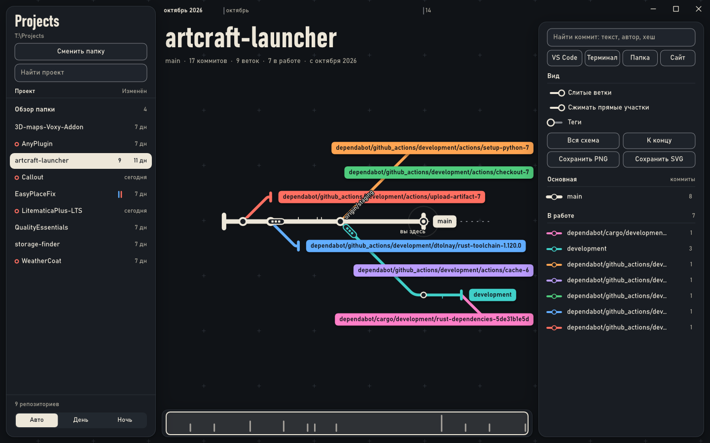
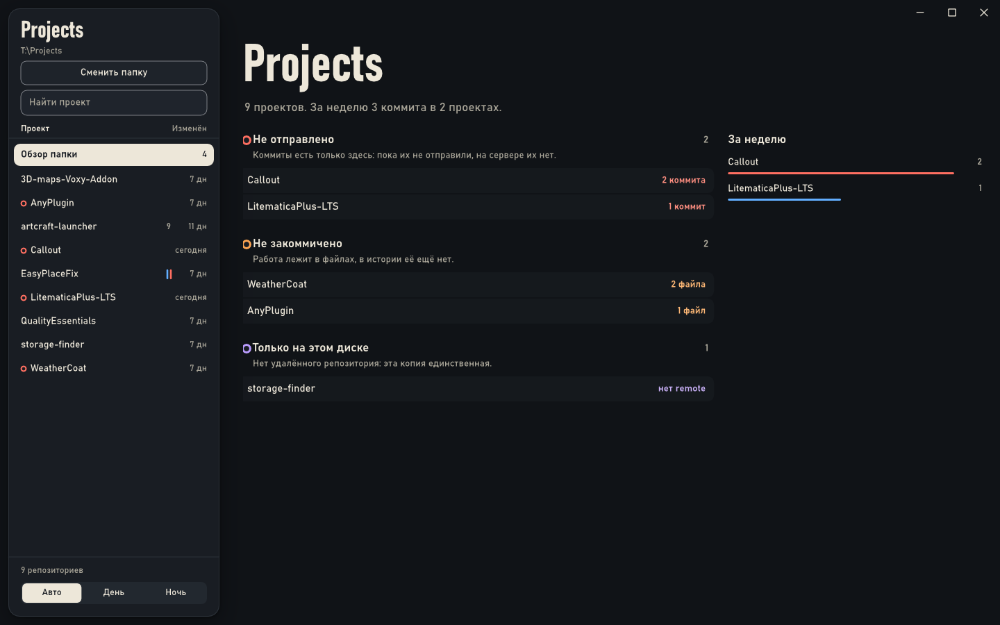

# GitMap

[](README.md)
[](README.md)
[](CHANGELOG.md)
[](LICENSE)

Windows app that draws the history of your git repositories as a living metro map: the main branch runs straight through the centre, other branches split off in colour and merge back.

**Руководство / User guide:** [Русский](docs/USER_GUIDE_RU.md) · [English](docs/USER_GUIDE_EN.md)





## Русский

### Что это

Карта веток показывает историю git-репозиториев как живую схему метро. Выбираешь папку, программа находит в ней все репозитории и показывает обзор: что менялось за неделю и где что не так. Щелчок по проекту открывает его схему: основная ветка идёт прямой линией по центру, остальные расходятся от неё цветными линиями и вливаются обратно.

Программа только читает. Она не меняет ни рабочие папки, ни `.git`, поэтому её можно наводить на чужие клоны. Git ставить не нужно.

### Возможности

- обзор папки: неотправленные коммиты, незакоммиченная работа, проекты без удалённого репозитория, заброшенные ветки, родственные проекты;
- живая схема: новые коммиты сами подъезжают на линию, а незакоммиченная работа видна пунктирным отростком от HEAD;
- изменения по строкам: для коммита, между любыми двумя коммитами и для всей ветки относительно основной;
- поиск коммита по тексту, автору и началу хеша;
- открытие проекта в VS Code, терминале, Проводнике или на сайте;
- экспорт схемы в PNG и SVG;
- светлая и тёмная тема, работа без анимаций, если они выключены в Windows.

### Установка

Скачай `GitMap-Setup.exe` со страницы [выпусков](https://github.com/ServChan/gitmap-releases/releases/latest) и запусти: откроется мастер. Программа ставится для одного пользователя в `%LOCALAPPDATA%\Programs\GitMap`, права администратора не нужны. Удаляется из «Приложений» Windows или повторным запуском установщика.

Раз в день программа проверяет новую версию и показывает кнопку обновления. Скачанное проверяется подписью ed25519, проверку можно выключить в окне. Настройки лежат в `%APPDATA%\GitMap\settings.json`.

### Сборка

Отладочная сборка открывается сразу, без мастера:

```bash
cargo run -- E:\Coding
```

Аргумент необязателен. Если это папка с проектами, она открывается в указателе. Если сам репозиторий, указателем становится родительская папка, а проект сразу открывается. Выпускная сборка без установки: `gitmap.exe --portable`.

```bash
cargo test
```

Устройство кода, проверка без окна и выпуск описаны в [docs/DEVELOPMENT.md](docs/DEVELOPMENT.md).

## English

### What It Is

GitMap shows the history of git repositories as a living metro map. Pick a folder and it finds every repository inside, then shows an overview of what changed this week and what needs attention. Click a project to open its map: the main branch runs in a straight line through the centre, the rest split off as coloured lines and merge back.

The app only reads. It never touches working folders or `.git`, so it is safe to point at other people's clones. Git itself does not need to be installed.

The interface is in Russian.

### Features

- folder overview: unpushed commits, uncommitted work, projects with no remote, abandoned branches, related projects;
- live map: new commits slide onto their line, and uncommitted work shows as a dashed stub from HEAD;
- line-by-line changes for a commit, between any two commits, and for a whole branch against the main one;
- commit search by text, author and hash prefix;
- open a project in VS Code, a terminal, Explorer or on its website;
- export the map to PNG and SVG;
- light and dark themes, and no animation when it is turned off in Windows.

### Installation

Download `GitMap-Setup.exe` from the [releases page](https://github.com/ServChan/gitmap-releases/releases/latest) and run it to open the wizard. It installs for one user into `%LOCALAPPDATA%\Programs\GitMap` and needs no administrator rights. Uninstall it from Windows Apps or by running the installer again.

Once a day the app checks for a new version and shows an update button. Downloads are verified with an ed25519 signature, and the check can be turned off in the window. Settings live in `%APPDATA%\GitMap\settings.json`.

### Building

A debug build opens right away, with no wizard:

```bash
cargo run -- E:\Coding
```

The argument is optional. A folder of projects opens in the project list. A repository opens directly, with its parent folder as the list. For a release build with no installation, use `gitmap.exe --portable`.

```bash
cargo test
```

Code structure, headless checks and releasing are covered in [docs/DEVELOPMENT.md](docs/DEVELOPMENT.md).

## Лицензия / License

[MIT](LICENSE)
